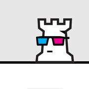

# Chess Server

Play chess against real people around the world — free, with nothing to download.

**[Play Chess Server — free](https://adrian3.github.io/chess-server/)**

Meet your next opponent on [FICS, the Free Internet Chess Server](https://www.freechess.org/), from your phone, tablet, or computer. Jump in as a guest, or sign in with your free FICS account.

## A seat at the board

- **Find a live opponent.** Create a game with your preferred time control and color, or join an open table.
- **Watch strong players.** Follow live games and see how experienced players handle the position.
- **Start simply.** Guest play lets you get straight to the board without creating an account.

## Start playing

1. Open Chess Server and choose **Guest** or **Registered User**.
2. Choose **Create New Game**, **View Open Tables**, or **Watch Top Players**.
3. Drag a piece to make your move.

**An internet connection is required.** Chess Server connects you to live games through an online relay. The first connection can take up to a minute while that service wakes up; keep the app open while it connects.

## From the App Store to the web

Originally released for iOS, Chess Server reached **7,860 App Store downloads**. It is now available free as a web app, with the same focus on getting you into a live game.

*Lifetime iOS download totals (first-time downloads/purchases), from Ade’s App Store Connect export of September 29, 2026.*

## Keep it on your home screen

These are progressive web apps (PWAs): open the link above to play, or install the app from your browser for quick access with its own icon.

**iPhone or iPad**
1. Open the app in **Safari**.
2. Tap **Share** (you may need to open the **Page Menu** first), then **Add to Home Screen**.
3. Turn on **Open as Web App** if that option appears, then tap **Add**.
4. Launch it from your home screen.

**Android**
1. Open the app in **Chrome**.
2. Tap **⋮** → **Add to home screen** → **Install** (or **Install app**, depending on your browser).
3. Follow the prompts, then launch it from your home screen or app drawer.

Need help? See [Apple’s home screen instructions](https://support.apple.com/guide/iphone/open-as-web-app-iphea86e5236/ios) or [Chrome’s installation guide](https://support.google.com/chrome/answer/9658361?co=GENIE.Platform%3DAndroid&hl=en).

## Four ways to enjoy chess

Originally released for iOS, this family of chess apps is now available **free as PWAs** on phones, tablets, and computers.

| App | Find your next challenge |
| --- | --- |
| [Chess Puzzles](https://adrian3.github.io/chess-puzzles/) | Find the checkmate in 367 puzzles. |
| [Eugene Chess](https://adrian3.github.io/eugene-chess/) | Play against the computer at your own pace. |
| [Chess Server](https://adrian3.github.io/chess-server/) | Play live opponents and watch games on FICS. |
| [Grandmaster Archive](https://adrian3.github.io/grandmaster-archive/) | Replay classic games and learn from the greats. |

Designed and developed by **[Ade Hanft](https://adrian3.com)**.
